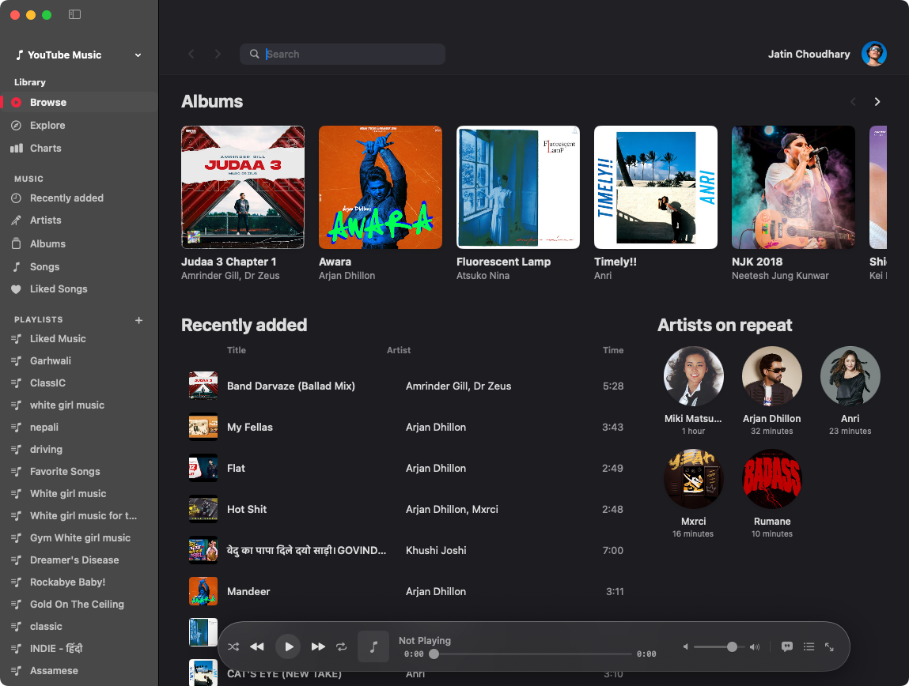

# Music

A native macOS YouTube Music client built with SwiftUI.



## What it does

- Clean macOS interface with translucent sidebar and a floating mini player
- Full library sync: Liked Songs, Saved Albums, Followed Artists, and Playlists
- Time-synced lyrics support
- Apple Music metadata integration for high-resolution album artwork
- Audio quality options, 10-band equalizer, and loudness normalization
- Offline downloads and local caching
- Last.fm scrobbling and Discord Rich Presence

## Building from source

Requirements: macOS 14.0+ and Xcode or Swift command-line tools.

Clone the repository and build:

```bash
git clone https://github.com/chaudharyjatin115/Music.git
cd Music
./bundle.sh release --install
```

This compiles the app and installs `Music.app` to `/Applications`.
